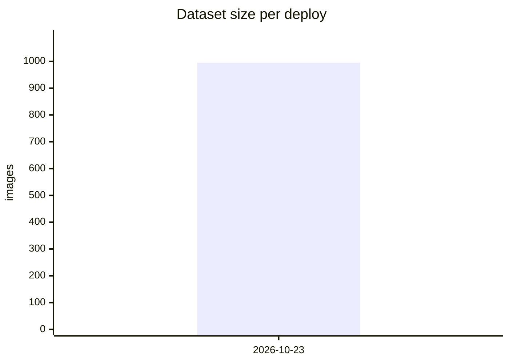

# Scripts

All scripts below live in **train/**:

- **train/model.py**: CaptchaModel (CNN + BiGRU + CTC), vocab and encode/decode. Single source of truth; the Rust solver mirrors it.
- **train/train.py**: Trains the model and exports `deploy/captcha_model.onnx` (+ external `.data`) in one run.
- **train/decode_captchas.py**: Exact-match eval of a trained model over `data/test`, writes `data/test_results.txt`.
- **train/package.py**: Zips the crowd labeler + data for PythonAnywhere upload.
- **train/update_chart.py**: Upserts the Deploys row in this README and regenerates the accuracy/dataset-size charts (run by the `model-refresh` workflow).
- **train/requirements.txt**: Python deps for the training scripts.

Subdirectories:

- **train/**: python files, venv (`.venv`), requirements, and the `model/` checkpoint dir.
- **train/model/**: training checkpoint (.pth) + tensorboard runs, gitignored.
- **labeler/**: Flask crowd-labeling site (deployed on PythonAnywhere) + `local.py` single-human labeler.
- **data/**: dataset (captchas + malformed + test), gitignored except those dirs.

## Deploys

Every `model-refresh` run upserts a row here via `update_chart.py` (charts show the last 12 months).

| Date | Images | Test accuracy % |
|---|---|---|
| 2026-10-23 | 995 | - |
<!-- /deploys-table -->

<!-- chart:images -->

<!-- /chart:images -->

<!-- chart:accuracy -->
```mermaid
xychart-beta
    title "Test accuracy per deploy"
    x-axis [2026-10-23]
    y-axis "accuracy" 0 --> 100
    bar []
```
<!-- /chart:accuracy -->

## Local labeling flow

After merging a `malformed` PR: `git pull` and run `python training/labeler/local.py`
(localhost:8765). Each submitted label renames+drops the captcha into `data/captchas`;
when the page says **malformed is empty**, `git add -A training/data && git commit -m labeled-$(date +%F) && git push && gh workflow run model-refresh`.
